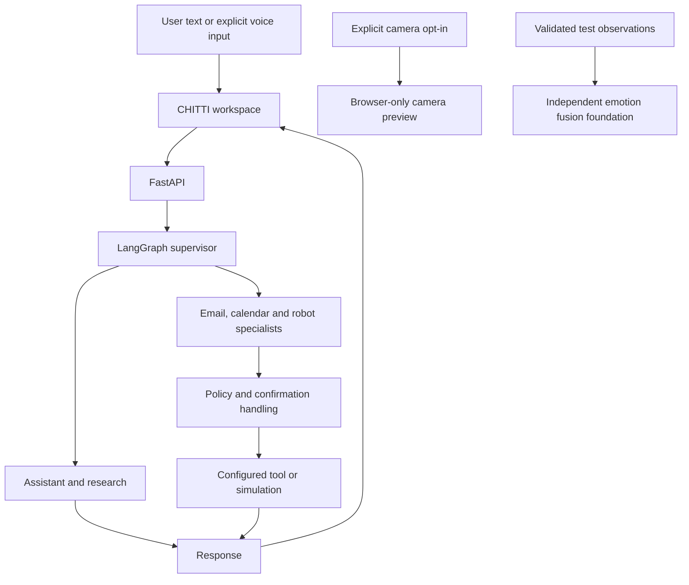

<div align="center">

# 🤖 CHITTI 2.0

### Your personal AI workspace — talk, research, plan, and act with control

CHITTI combines a **React + TypeScript interface**, a **FastAPI backend**, and a **LangGraph supervisor** for multilingual assistance, voice commands, research, and connected productivity tools.

**Emotion intelligence is under development.** Local camera preview and the tested emotion-session/fusion foundation are implemented; real facial-expression and voice-emotion models are not connected yet.

[](https://www.python.org/)
[](https://fastapi.tiangolo.com/)
[](https://react.dev/)
[](https://www.typescriptlang.org/)
[](https://vite.dev/)
[](https://www.langchain.com/langgraph)
[](https://pytest.org/)

[](https://github.com/Lokesh-069/Chitti-2.0/stargazers)
[](https://github.com/Lokesh-069/Chitti-2.0/forks)
[](https://github.com/Lokesh-069/Chitti-2.0/tree/chitti-2.0-development)

</div>

---

## 📚 Table of Contents

- [✨ Key Features](#features)
- [🛠️ Technology Stack](#stack)
- [🧭 Application Flow](#flow)
- [🖥️ Application Areas](#areas)
- [🚀 Run Locally](#setup)
- [📁 Project Structure](#structure)
- [🔐 Privacy and Safety](#safety)
- [🧪 Verification](#verification)
- [🎓 Demonstration Guide](#demo)
- [🗺️ Remaining Work](#roadmap)

---

<a id="features"></a>
## ✨ Key Features

### 🧠 Personal assistant

- Text-based conversation through the existing assistant workflow.
- LangGraph supervisor and specialists for assistance, email, calendar, briefings, research, and robot commands.
- Configurable model providers with deterministic routing and fallback behavior.
- Confirmation prompts for consequential assistant actions; integrations require their own configuration and authorization.

### 🎙️ Voice and language

- **“Hey CHITTI”** wake phrase and manual microphone controls.
- English, Hindi, Bengali, and mixed-language interaction paths.
- Speech-to-text adapters for Groq, Gemini, and local Whisper, subject to credentials and runtime availability.
- Spoken response support through configured providers and browser speech synthesis.
- Existing voice commands remain separate from emotion analysis.

### 📬 Research and productivity

- Gmail and Calendar adapters with explicit connection status.
- Research retrieval and analysis using configured providers.
- Briefings, follow-ups, and account-linked activity records.
- Optional invoice acknowledgement automation: enabling it authorizes its configured behavior, rather than requiring confirmation for every reply.
- Robot command routing includes simulation; physical robot operation is not verified.

### 📷 Camera and emotion intelligence

| Capability | Current status |
|:---|:---|
| Local camera preview | Implemented; starts after an explicit click and browser permission |
| Camera Stop and cleanup | Implemented; lifecycle covered by mocked-stream tests |
| Face detection | Not integrated |
| Facial-expression classification | Model unavailable |
| Voice-emotion classification | Model unavailable |
| Typed emotion observations | Implemented and tested |
| Separate consent and emotion sessions | Backend foundation implemented and tested |
| Deterministic multimodal fusion | Implemented and tested with test observations; not connected to live inference |

> 💡 Camera preview is not emotion recognition. It does not record or upload video, create an emotion session, or grant backend consent. No fabricated emotion prediction is shown.

---

<a id="stack"></a>
## 🛠️ Technology Stack

<div align="center">

| Layer | Technology |
|:---|:---|
| 🐍 **Backend** | Python · FastAPI · Uvicorn · Pydantic |
| 🕸️ **Orchestration** | LangGraph supervisor and specialist graphs |
| ⚛️ **Frontend** | React · TypeScript · Vinext · Vite · Next-compatible APIs |
| 🎨 **Interface** | CSS · Tailwind tooling · Responsive workspace components |
| 🎙️ **Voice** | Browser media APIs · VAD · Provider-based STT/TTS |
| 💾 **Storage** | SQLite account/session/activity storage · In-memory graph checkpoints |
| 🔗 **Integrations** | Google OAuth · Gmail · Calendar · Research providers |
| 🧪 **Testing** | Pytest · Node test runner · TypeScript · ESLint |
| 📦 **Build tooling** | Cloudflare Vite plugin · Wrangler |

</div>

> The application currently runs as a browser frontend and Python backend. A Tauri desktop application is not implemented.

---

<a id="flow"></a>
## 🧭 Application Flow



1. The current account flow validates a backend-issued bearer session before opening the full workspace.
2. The user types a request or explicitly activates voice input.
3. The backend routes the request to the relevant specialist.
4. The interface shows results, connection errors, or confirmation requests.
5. Emotion processing remains separate from agent execution and cannot authorize actions.

---

<a id="areas"></a>
## 🖥️ Application Areas

| Area | Purpose |
|:---|:---|
| 💬 **Assistant workspace** | Conversation, command input, voice controls, and response status |
| 📊 **Dashboard** | Profile context, activity, and available productivity information |
| 🔗 **Connections** | Google connection status and supported automation controls |
| 🔍 **Research** | Structured business context and source-based research requests |
| 📷 **Camera preview** | Local video with explicit Start/Stop controls |
| 🧠 **Emotion availability** | Honest status for models and inference that are not yet integrated |

---

<a id="setup"></a>
## 🚀 Run Locally

### ✅ Prerequisites

- Git, Python, Node.js, and npm accessible from your terminal.
- The current environment was tested with **Python 3.12.14** and **Node.js 24.22.3**. The frontend declares Node.js **22.13.0 or newer**.
- Provider credentials only for the services you intend to use. Without them, some features use deterministic or simulated behavior.
- Browser camera/microphone permission only when you explicitly activate a device.

### 📋 Initial setup

**1. Clone the development branch**

```powershell
git clone --branch chitti-2.0-development https://github.com/Lokesh-069/Chitti-2.0.git
Set-Location Chitti-2.0
```

> This README describes the current local development work. Some features and tests are still uncommitted and may not yet be available in a fresh GitHub clone.

**2. Prepare dependencies on a new checkout**

```powershell
py -3.12 -m venv .venv
& '.\.venv\Scripts\python.exe' -m pip install -r requirements.txt
Set-Location frontend
npm.cmd ci
Set-Location ..
```

Reuse an existing prepared environment rather than reinstalling it. The Python requirements include Whisper and its ML dependencies; review compatibility and installation size first. Earlier Windows checks encountered a PyTorch Code Integrity issue and missing FFmpeg. Do not bypass Windows policies; local Whisper is not a guaranteed fallback on this machine.

**3. Configure only the providers you need**

Use `.env.example` as the configuration reference. For a new checkout, create `.env` only if it does not already exist:

```powershell
if (-not (Test-Path -LiteralPath '.env')) {
    Copy-Item -LiteralPath '.env.example' -Destination '.env'
}
```

Add your own provider configuration privately. Google integrations require OAuth setup and explicit consent. Do not commit credentials or replace an existing `.env`.

### ▶️ Launch in two PowerShell terminals

**Terminal 1 — backend, from the repository root:**

```powershell
& '.\.venv\Scripts\python.exe' -m uvicorn backend.api:app --host 127.0.0.1 --port 8000
```

**Terminal 2 — frontend, from the repository root:**

```powershell
Set-Location frontend
npm.cmd run dev -- --host localhost --port 5173
```

Open **[CHITTI at localhost:5173](http://localhost:5173/)**. API documentation is at **[127.0.0.1:8000/docs](http://127.0.0.1:8000/docs)**. The development server proxies `/api` to port 8000.

The current application still requires an account session. Password-free local profiles and automatic secure bootstrap are not implemented. No account password or universal login token is provided in this repository.

### 🔧 Common startup issues

| Problem | What to check |
|:---|:---|
| Port 8000 is already in use | An existing backend may already be running; check it before launching another |
| `npm` or `node` is not recognized | Ensure both Node.js and npm are on the terminal PATH |
| PowerShell blocks scripts | Use the executable commands above; virtual-environment activation is unnecessary |
| Frontend opens but API requests fail | Check port 8000 and `http://localhost:5173/api/health` |
| Camera does not open | Check browser permission and whether another application is using it |
| Emotion predictions are absent | Expected: classifiers are not connected yet |

---

<a id="structure"></a>
## 📁 Project Structure

```text
Chitti-2.0/
│
├── backend/
│   ├── api.py                    # HTTP endpoints and application lifecycle
│   ├── config.py                 # Environment and provider configuration
│   ├── graphs/                   # Supervisor and specialist LangGraph workflows
│   ├── nodes/                    # Routing, context, policy and confirmation nodes
│   ├── services/                 # Auth, persistence, providers and integrations
│   ├── emotion/
│   │   ├── contracts.py          # Validated observation and fusion models
│   │   ├── fusion.py             # Deterministic fusion engine
│   │   └── api.py                # Consent-bound session and observation endpoints
│   └── tests/
│
├── frontend/
│   ├── app/
│   │   ├── page.tsx              # Account entry and assistant workspace
│   │   ├── layout.tsx            # Application metadata and root layout
│   │   ├── globals.css           # Workspace styles
│   │   ├── components/           # Navigation, conversation and device interface
│   │   └── lib/
│   │       ├── aether-api.ts     # Existing API client; compatibility filename
│   │       ├── wake-phrase.ts    # Voice-command phrase handling
│   │       └── emotion/          # Contracts, service and camera preview lifecycle
│   ├── tests/
│   ├── public/                   # Static and existing voice runtime assets
│   ├── vite.config.ts            # Build configuration and local API proxy
│   └── package.json
│
├── .planning/chitti/              # Architecture and verification reports
├── context/                      # Historical technical context
├── .env.example                  # Configuration reference
├── .gitignore
├── requirements.txt
├── pytest.ini
├── start.ps1                     # Existing launcher; needs Python/npm on PATH
└── README.md
```

---

<a id="safety"></a>
## 🔐 Privacy and Safety

| Boundary | Current behavior |
|:---|:---|
| 🔐 **Account identity** | Protected account/dashboard routes validate server-issued sessions; browser IDs alone are not authorization |
| 📷 **Camera** | Explicit Start; no recording/upload in the preview; Stop and component cleanup release tracks |
| 🎙️ **Microphone** | Voice-command activation is separate from emotion consent |
| 🧠 **Emotion sessions** | Separate modality consent, account ownership, expiration, revocation, and request limits |
| 🚦 **Agent actions** | Existing policy and confirmation handling remain in place |
| 💾 **Secrets** | Environment files, credential material and local data are excluded by Git ignore rules |

**Development limitations:** account bearer tokens currently use browser local storage. Some legacy API endpoints allow unauthenticated access. Emotion sessions and rate limits are process-local, not distributed controls. Do not expose this development setup publicly or run multiple workers without an additional security review. Conversation checkpoints are in memory, not guaranteed persistent history.

---

<a id="verification"></a>
## 🧪 Verification

**Backend, from the repository root:**

```powershell
& '.\.venv\Scripts\python.exe' -m pytest -q -p no:cacheprovider
```

**Frontend, from `frontend`:**

```powershell
node --test tests/*.test.mjs
& '.\node_modules\.bin\tsc.cmd' --noEmit --incremental false
npm.cmd run lint
npm.cmd run build
```

Latest recorded local verification on **26 November 2026**:

| Check | Result |
|:---|:---|
| Backend suite | 168 passed |
| Frontend suite | 46 passed |
| TypeScript and ESLint | Passed |
| Production compilation | Passed in an isolated copy using existing dependencies |
| Frontend-to-backend health request | HTTP 200 |
| Physical camera/microphone and visual browser validation | Not verified |

The production build reported Vinext/Vite warnings about source maps, chunk size, dynamic imports, and static route classification. Passing tests do not establish hardware compatibility or real emotion-model accuracy.

---

<a id="demo"></a>
## 🎓 Demonstration Guide

1. Start both services and open the workspace with an existing valid account session.
2. Send **help** to demonstrate assistant routing and the conversation interface.
3. Explain whether each integration is connected or simulated before demonstrating it.
4. Choose **Start camera** and grant permission only if you want to show the local preview; use **Stop camera** afterward.
5. Show the explicit model-unavailable status. Do not describe the preview as face detection or emotion inference.
6. Discuss the tested emotion contracts, consent lifecycle, and fusion engine as the foundation for future model integration.

---

<a id="roadmap"></a>
## 🗺️ Remaining Work

- Secure password-free local-profile bootstrap and reversible account migration.
- Licensed, compatible face and voice emotion classifiers with quality evaluation.
- Face detection, live observations, and fusion-result presentation.
- Browser/hardware testing, microphone coordination, and accessibility review.
- Shared session storage and coordinated limits before multi-worker deployment.
- Desktop packaging and a portable Windows startup experience.

---

<div align="center">

### 🌟 CHITTI 2.0 — Personal assistance, explicit control, honest capabilities 🌟

[Explore the development branch](https://github.com/Lokesh-069/Chitti-2.0/tree/chitti-2.0-development)

</div>
